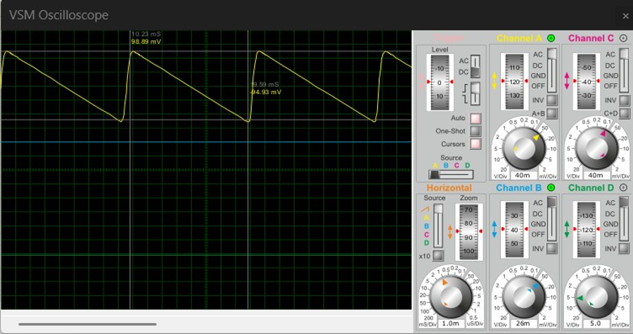
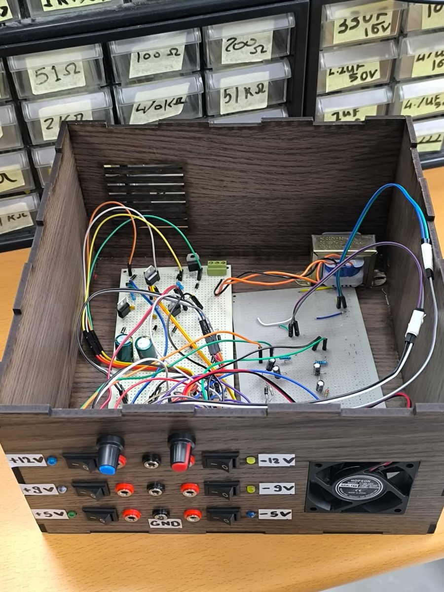

# Multi-Output Regulated DC Power Supply

A six rail regulated DC power supply delivering fixed ±5V and ±9V outputs
alongside adjustable ±12V outputs, designed in NI Multisim and realized as a
soldered hardware prototype.

Final project, Electrical Engineering II (MNG 232), Nile University.

| | |
|---|---|
| Design team | Abdullah Salem, Abdullah Mohamed, Mohamed Sallam, Ziad Ali |
| Supervisor | Dr. Mohamed Elhossainy |
| Date | May 9, 2026 |

## Overview

The supply converts single phase 220V AC mains into six independent regulated
DC rails using a center tapped step down transformer, a full wave bridge
rectifier, capacitive filtering, and linear IC regulation. Fixed rails use the
78xx/79xx family, and the adjustable ±12V rails use LM317/LM337 regulators
with a potentiometer for continuous tuning.

The design was carried through three stages: circuit simulation in NI
Multisim, analytical hand calculation of every stage, and physical assembly
on a soldered board with empirical validation using a digital multimeter and
a Tektronix DPO4104 oscilloscope.

## Output Specification

| Rail | Type | Regulator |
|---|---|---|
| +5V | Fixed | 7805 |
| -5V | Fixed | 7905 |
| +9V | Fixed | 7809 |
| -9V | Fixed | 7909 |
| +12V | Adjustable | LM317 |
| -12V | Adjustable | LM337 |

## Signal Path

1. 12-0-12V center tapped step down transformer
2. Full wave bridge rectifier (2W005G)
3. Capacitive filtering, 2200µF per rail
4. Linear IC regulation (fixed and adjustable stages)
5. Output decoupling, 100nF and 10µF
6. Terminal block with LED rail indicators

## Key Results

All six rails stayed within 4% of their simulated targets when measured on
the finished hardware.

| Rail | Simulated | Measured | Error |
|---|---|---|---|
| +5V Fixed | 5.01V | 4.93V | 1.59% |
| -5V Fixed | -5.03V | -4.96V | 1.39% |
| +9V Fixed | 9.01V | 9.29V | 3.11% |
| -9V Fixed | -9.01V | -9.08V | 0.78% |
| +12V Variable | 11.8V | 12.26V | 3.90% |
| -12V Variable | -11.9V | -12.27V | 3.11% |

Simulated ripple on the unfiltered rectifier output was measured at
197.78mV peak to peak. After the 2200µF filter stage, the oscilloscope
traces on every finished rail show a flat DC level with negligible residual
ripple, confirming the filtering and regulation stages perform as designed.

Full detail is in [docs/test-results.md](docs/test-results.md).

## Simulation: Ripple Before Filtering



Cursor based measurement on the unfiltered full wave rectified node: crest at
98.89mV, trough at -98.89mV, giving a peak to peak ripple of 197.78mV before
the filter capacitors are applied.

## Finished Prototype



The circuit was moved from breadboard to a permanent soldered board and
housed in a custom enclosure with front panel terminals for all six outputs,
a ground reference, two calibration dials for the adjustable rails, and
power indicator LEDs.

## Repository Structure

```
.
├── README.md
├── docs/
│   ├── design-calculations.md    Transformer, rectifier, filter, and regulator math
│   ├── bill-of-materials.md      Full component list
│   └── test-results.md           Simulated vs measured comparison and scope traces
└── images/
    ├── ripple-waveform-simulation.png
    ├── assembled-prototype.jpg
    ├── scope-plus5v.jpg
    ├── scope-minus5v.jpg
    ├── scope-plus9v.jpg
    ├── scope-minus9v.jpg
    ├── scope-plus12v.jpg
    └── scope-minus12v.jpg
```

## Conclusion

Every rail tracked its simulated target within a 4% margin, and oscilloscope
validation confirmed clean, low noise DC output on all six channels. The
result is a reliable bench grade multi rail supply suitable for powering and
testing sensitive electronic instrumentation.
