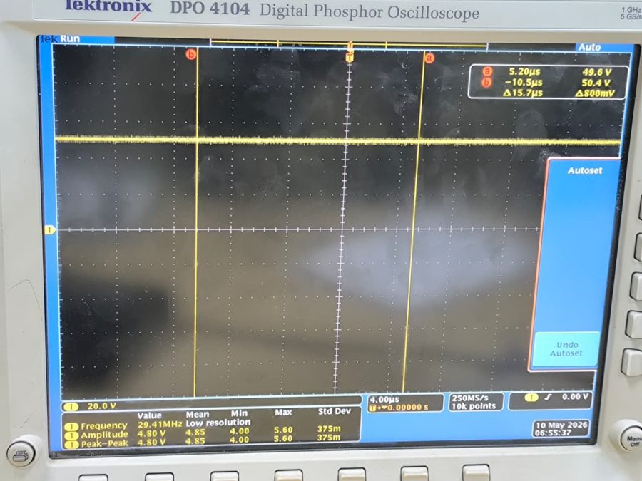
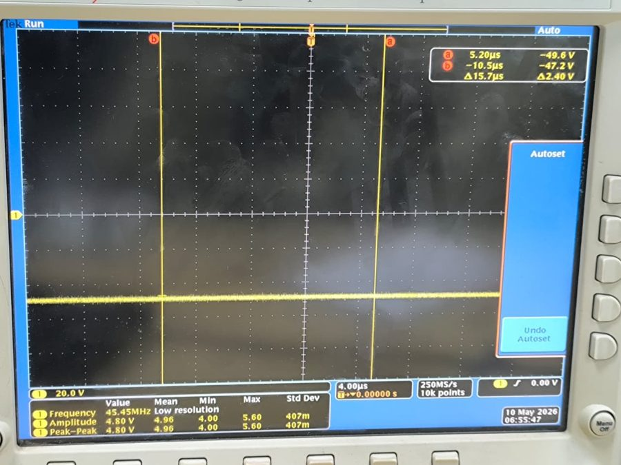
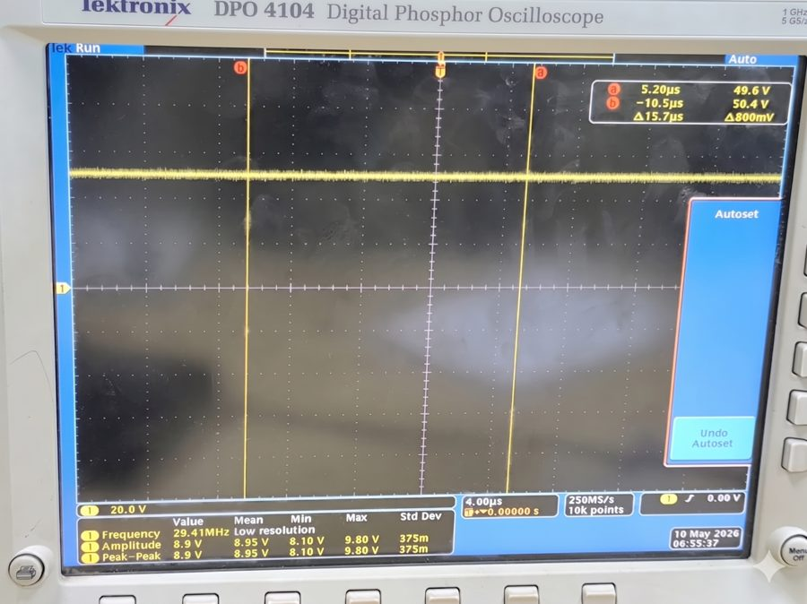
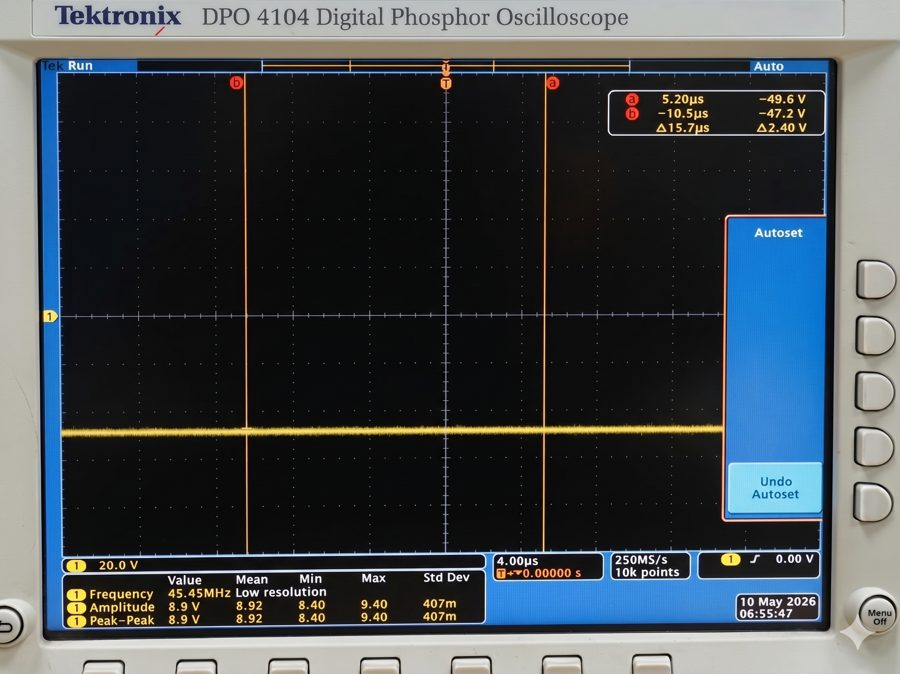
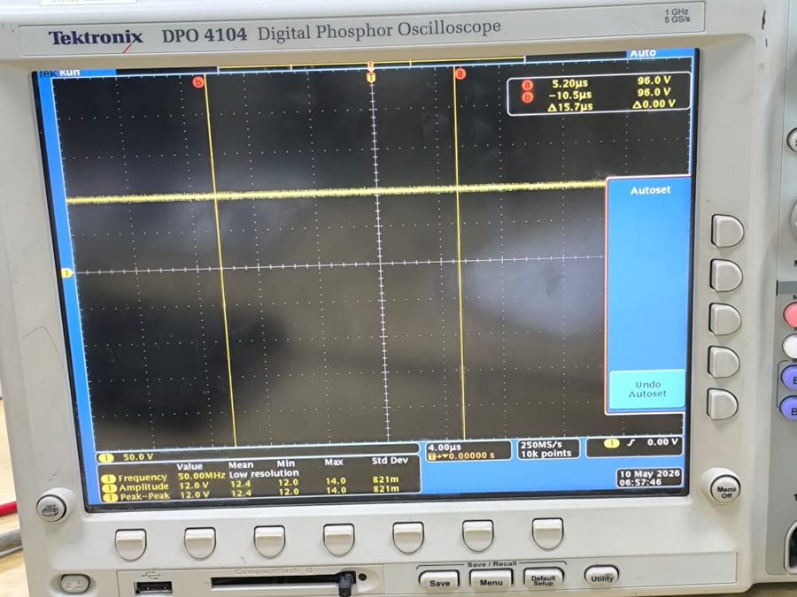
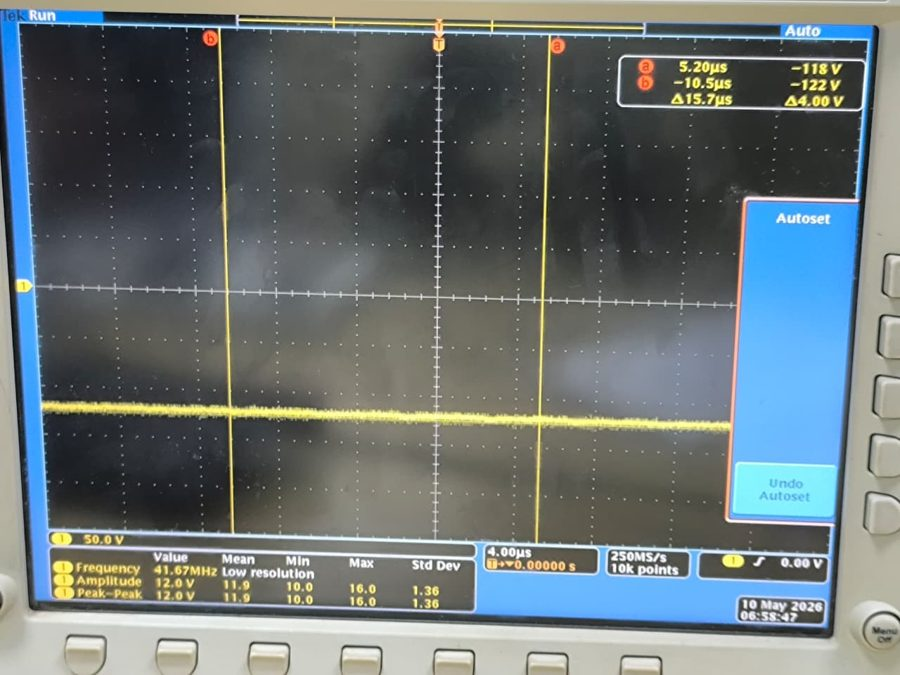

# Oscilloscope Gallery

All six output rails probed directly at their terminals on the finished
hardware, using a Tektronix DPO4104 digital phosphor oscilloscope. Each
trace is read at 20mV per division (fixed rails) or 50mV per division
(variable rails) with cursor markers a and b placed for reference.

## Fixed Rails

| +5V | -5V |
|---|---|
|  |  |
| Mean 4.85V, amplitude 4.80V | Mean 4.96V, amplitude 4.80V |

| +9V | -9V |
|---|---|
|  |  |
| Mean 8.95V, amplitude 8.90V | Mean 8.92V, amplitude 8.90V |

## Variable Rails (maximum dial position)

| +12V | -12V |
|---|---|
|  |  |
| Mean 12.4V, amplitude 12.0V | Mean 11.9V, amplitude 12.0V |

## Reading

Every trace holds a flat line with only thin band noise, no sawtooth
residual from the rectifier and no low frequency drift. This confirms the
2200µF filter stage and the linear regulators suppress the 100Hz rectified
ripple on every rail, fixed and adjustable alike.

For the numeric comparison against the simulated targets, see
[test-results.md](test-results.md).
